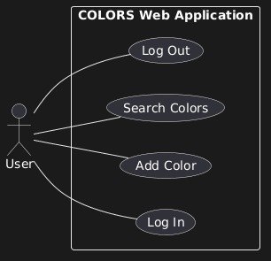
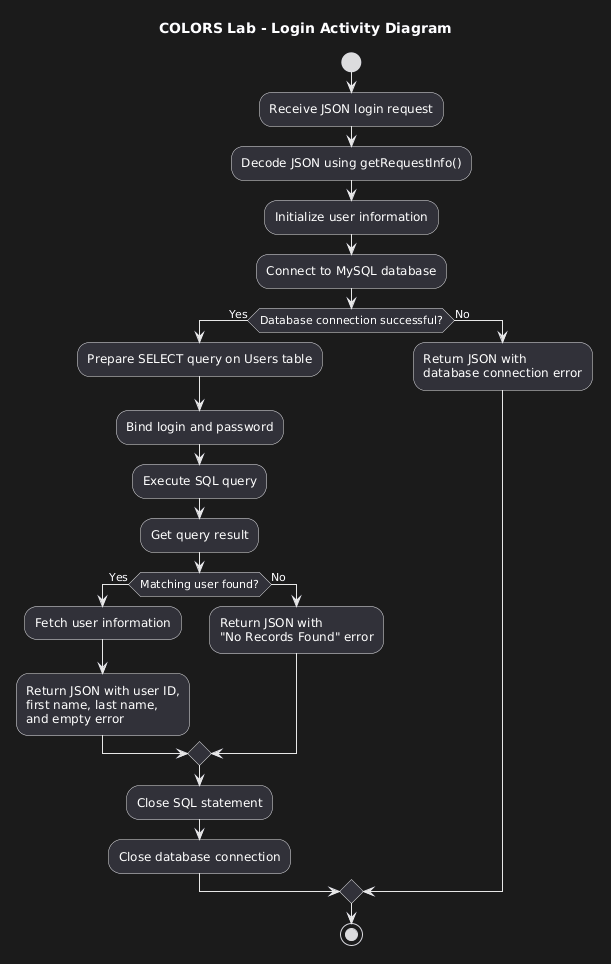
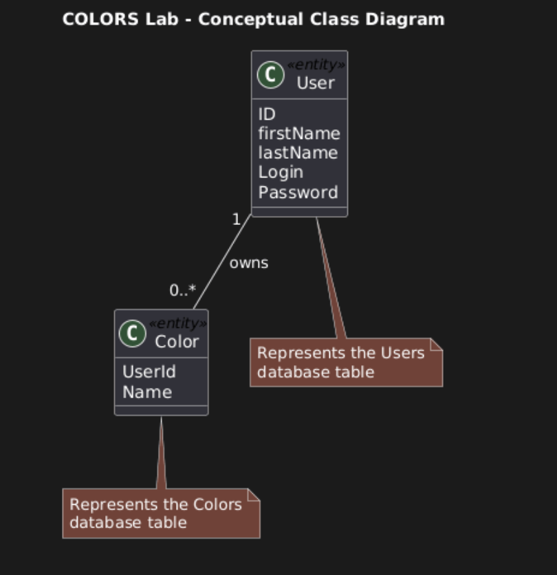

# COLORS Lab – COP 4331

## About the Project

The COLORS Lab is a web application I worked on for my COP 4331 class. The main goal of this project was to get familiar with full-stack web development and understand how the frontend, backend, and database work together.

The application allows users to log in, add colors, and search for colors they've previously saved. Throughout the project, I worked with HTML, CSS, JavaScript, PHP, and MySQL.

This lab also gave me experience working with APIs, sending and receiving JSON data, using GitHub for version control, and creating UML diagrams to represent the application's design.

## Technologies Used

- **HTML & CSS:** Used to build and style the website.
- **JavaScript:** Used for frontend interactions and communication with the backend.
- **PHP:** Used to create the backend API endpoints.
- **MySQL:** Used to store user information and saved colors.
- **LAMP Stack:** Used for the server-side environment.
- **Git & GitHub:** Used to manage and upload my project files.
- **PlantUML:** Used to create the UML diagrams.

## Application Features

### User Login

Users can enter their username and password to log into the application.

The `Login.php` endpoint checks the credentials against the MySQL database. If a matching user is found, it returns their information. Otherwise, it returns an error message.

### Add Color

Once logged in, users can enter a color name and save it.

The `AddColor.php` endpoint adds the color to the database and connects it to the user's ID.

### Search Colors

Users can search for colors they've already added.

The `SearchColors.php` endpoint searches the database using the text entered by the user and returns matching colors associated with their account.

### Log Out

The application also includes a logout button on the color management page.

## How the Application Works

The application uses HTML and CSS for the frontend, PHP for the backend, and MySQL for the database.

When a user performs an action, such as logging in or adding a color, the frontend sends a request to the corresponding PHP endpoint.

The PHP code communicates with the MySQL database and returns a JSON response containing the requested information or an error message.

This helped me better understand how APIs connect the frontend of a website to its backend.

## API Endpoints

The project includes three main PHP endpoints:

| Endpoint | Purpose |
|---|---|
| `Login.php` | Checks a user's login credentials. |
| `AddColor.php` | Saves a new color associated with a user. |
| `SearchColors.php` | Searches for colors previously saved by a user. |

## Database

The application uses two main database tables:

- **Users:** Stores user information, including their ID, name, and login credentials.
- **Colors:** Stores saved color names and associates each color with a user ID.

The relationship between these tables allows one user to have multiple saved colors.

## UML Diagrams

As part of the software design portion of the assignment, I created three UML diagrams using PlantUML. These diagrams helped me understand how to represent the application's functionality, workflow, and structure.

### 1. Use Case Diagram

The Use Case Diagram shows how a user interacts with the COLORS application.

It includes logging in, adding colors, searching for colors, and logging out.



### 2. Activity Diagram

The Activity Diagram focuses on the login process.

It shows how the application receives login information, connects to the database, checks the user's credentials, and returns either the user's information or an error message.



### 3. Class Diagram

The Class Diagram shows the relationship between the User and Color entities.

Since the application uses procedural PHP instead of object-oriented PHP classes, I created a conceptual diagram based on the database structure.

The diagram shows that one user can have multiple saved colors, while each color is associated with one user.



## Project Structure

```text
colorslab/
├── css/
├── docs/
│   └── uml/
│       ├── usecase.puml
│       ├── usecase.png
│       ├── activity.puml
│       ├── activity.png
│       ├── class.puml
│       └── class.png
├── images/
├── LAMPAPI/
│   ├── Login.php
│   ├── AddColor.php
│   └── SearchColors.php
├── index.html
├── color.html
└── README.md
```

## What I Learned

Working on the COLORS Lab helped me get a better understanding of how different parts of a web application connect.

I became more familiar with PHP APIs, MySQL queries, and how information is passed between the frontend and backend using JSON.

Creating the UML diagrams also helped me look at the application from a software design perspective instead of just focusing on the code. I learned how to represent user interactions, break down a process into individual steps, and show relationships between different parts of a system.

Overall, this project gave me more hands-on experience with full-stack development and helped me become more comfortable understanding how a web application works behind the scenes.